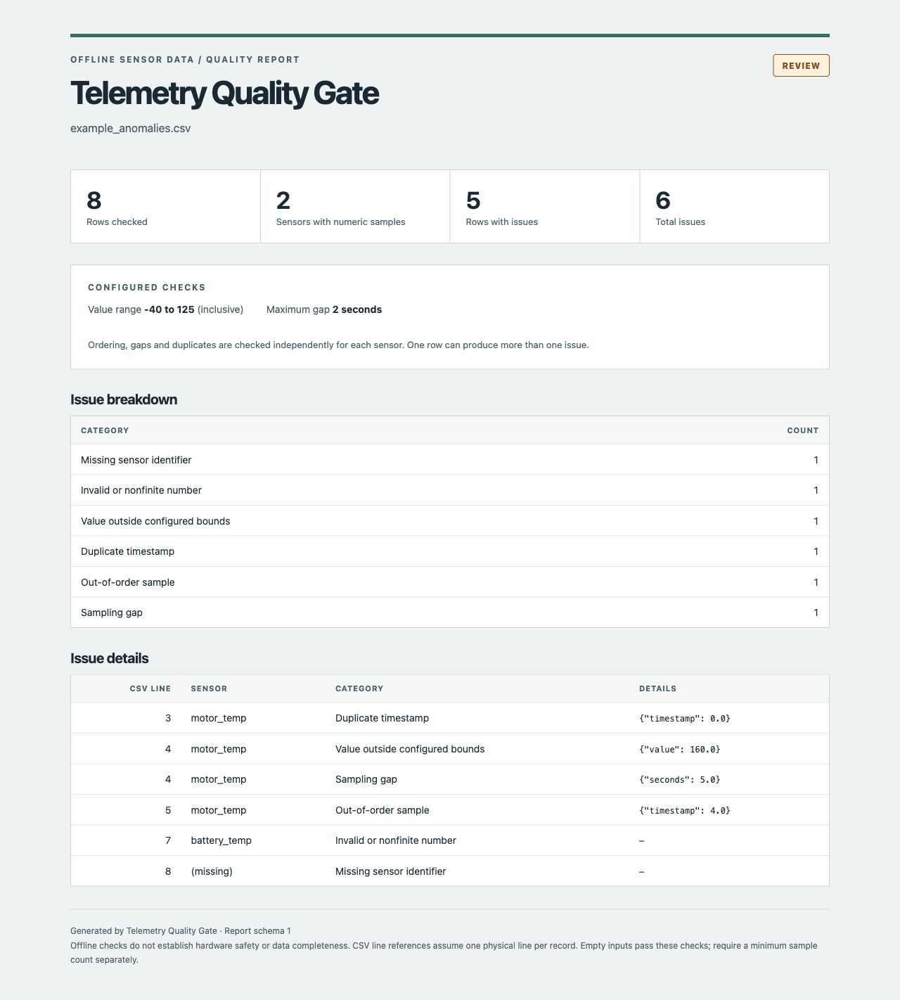

# Telemetry Quality Gate

[](https://github.com/arslan1t/telemetry-quality-gate/actions/workflows/ci.yml)


[](LICENSE)

A dependency-free Python CLI that checks timestamped sensor CSV files before
analysis. Reports duplicate timestamps, out-of-order samples, sampling gaps,
invalid numbers, missing sensor identifiers, and values outside configured bounds.
An optional minimum record count catches empty or unexpectedly short exports.

Get structured JSON for automation and an optional standalone HTML report for
reviewing the same result in a browser. The HTML file has no external assets,
scripts, or dependencies.

Python 3.10+. Intended for offline engineering datasets and CI checks.



## Run

```sh
python3 telemetry.py example.csv --minimum -40 --maximum 125 --max-gap 2
python3 telemetry.py example_anomalies.csv --html-report quality-report.html > report.json
python3 -m unittest -v
```

The supplied example deliberately contains anomalies, so the first command exits
with status **1**. Exit 0 means all configured checks passed; 2 means a file/configuration error.
The report is valid JSON and can be redirected to a file.

`--html-report PATH` additionally writes a UTF-8 HTML file. JSON remains on stdout,
and finding issues still returns 1. File or configuration errors return 2 without
JSON output. A report path matching the input CSV is rejected to prevent replacing
the dataset. Parent directories must already exist; an existing report is replaced.

## Require a minimum record count

An export with a header but no samples passes the row-level checks by default.
Use `--min-rows N` when a pipeline expects a known minimum number of CSV records:

```sh
python3 telemetry.py example_empty.csv --min-rows 1 --html-report empty-report.html
python3 telemetry.py example_valid.csv --min-rows 8
```

The header-only fixture fails the first command with exit **1**; the second passes
with exit **0**. The threshold is inclusive: exactly N records is sufficient.
The default is 0, preserving existing JSON results and HTML output. Negative or
noninteger thresholds are configuration errors (exit **2**, no JSON).

This is a dataset-wide count of **all parsed CSV records**, including records with
invalid samples. It is not a minimum valid-sample count or a per-sensor coverage
guarantee; all existing sample checks still apply independently.

When the count is below the threshold, schema 1 adds one `insufficient_rows` issue:

```json
{"line": null, "sensor": "", "kind": "insufficient_rows", "scope": "dataset", "minimum": 1, "actual": 0}
```

`line` is nullable for a dataset issue because missing records have no CSV line.
Sample issues retain their integer line references. The HTML report labels the
issue **Dataset**, includes it in total issues, and excludes it from rows with
issues. The minimum setting and seventh category appear only when enabled.

For direct Python use, pass `min_rows=N` to `audit(...)` and the same threshold to
`render_html(..., min_rows=N)`. The API requires a nonnegative integer; booleans
are rejected.

## Try a complete example

These fixtures are **synthetic** and make no claim about real hardware:

| Input | Rows | Sensors with numeric samples | Expected result |
| --- | ---: | ---: | --- |
| `example_valid.csv` | 8 | 2 | Pass, no issues, exit 0 |
| `example_anomalies.csv` | 8 | 2 | 6 issues across 5 rows, exit 1 |
| `example_empty.csv` | 0 | 0 | Pass by default; fail with `--min-rows 1` |

```sh
python3 telemetry.py example_valid.csv --html-report clean-report.html
python3 telemetry.py example_anomalies.csv --html-report quality-report.html
```

Open the generated file in a browser, or inspect the checked-in
[sample HTML report](example-report.html), generated from `example_anomalies.csv`
with the default thresholds. It contains overall row/sensor counts, the count of
rows with issues, all six category counts (including zero counts), configured
thresholds, and per-issue CSV line references and details. A row can have more than
one issue, so the issue count can exceed the number of affected rows. All source
names and sensor identifiers are HTML-escaped before rendering.

## Input contract

Required headers: `timestamp,sensor,value`. Timestamps are finite numeric seconds
on a consistent clock. Values are finite numeric measurements in one common unit.
Rows may interleave sensors; ordering and gaps are evaluated independently per
sensor. Boundaries are inclusive; a gap is flagged only when strictly greater
than `--max-gap`. CSV line references assume one physical line per record.

## Example report

The sample produces one each of: `duplicate_timestamp`, `sampling_gap`,
`out_of_range`, `out_of_order`, and `invalid_number`. Each issue includes the
record line and sensor. A row can produce multiple issues.

## Design decisions

- Never silently coerce NaN or infinity into valid measurements.
- Keep a per-sensor timestamp high-water mark, so a late arrival does not create
  a spurious gap on the next valid sample.
- Preserve anomalies as structured records, suitable for scripts and CI.
- Keep the parser and validation core separate for direct unit testing.

Time complexity is O(N). Memory is O(N): the current CLI loads records, retains
seen timestamps for exact duplicate detection and collects the full issue report.
This is deliberately an offline validator, not a bounded-memory streaming service.

## Validation and limits

Tests cover interleaved sensors, every issue category, threshold boundaries,
nonfinite values, invalid configuration, CSV schema and late-arrival handling,
known synthetic fixture counts, HTML escaping, minimum-count boundaries and
dataset-wide issue rendering, and CLI JSON/HTML consistency and exit statuses.
No inferred sample rate, clock-drift correction, unit conversion or automatic data
repair. Thresholds must be selected for the actual sensor. Empty datasets pass
vacuously and report zero rows unless `--min-rows` is enabled. A minimum total
record count cannot detect every form of truncation or establish sensor coverage.

## Development

The GitHub Actions workflow runs the test suite on Python 3.10, 3.12, and 3.13.
It also checks the clean/anomalous CLI fixtures and regenerates the sample HTML
report to check that the committed example matches the code.

No production deployment or hardware integration is claimed. MIT licensed.
